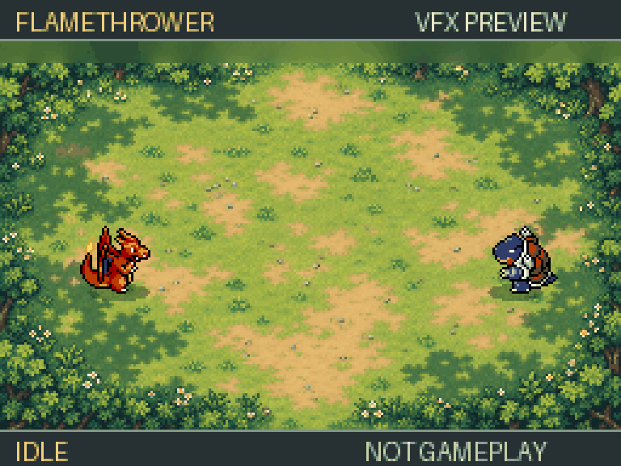

# Flamethrower visual preview

Standalone animation mock-up using the supplied game sprites and effects. This is not ROM gameplay and does not change the game.

- [Download GIF](flamethrower-preview.gif?raw=true) — 4.48 seconds, looping, 768×576, 478 KB.
- [Watch or download MP4](flamethrower-preview.mp4?raw=true) — 4.48 seconds, 256 KB.

Both exports are silent. No ROM was built for this preview.

Assets: accepted Arena directional Charizard and Blastoise sprites; user-supplied Pokémon Ranger: Guardian Signs flame strips 104/106; King of Fighters XI impact frames 0–7; Pokémon Mystery Dungeon: Explorers of Sky smoke sequence 0097. The background is the previously supplied forest arena artwork.

Original sprite artist credits are retained in [the project's sprite credits](../../ds/assets/CREDITS.md). Pokémon assets are from their respective games and the supplied SpriteCollab artwork; KOF effects are from SNK's game.
