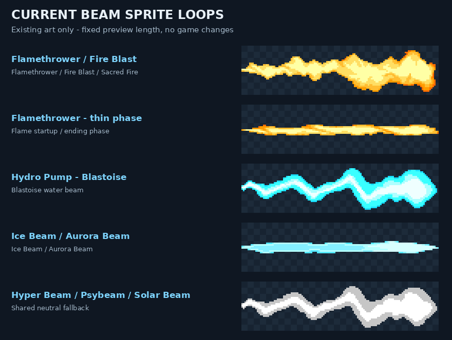
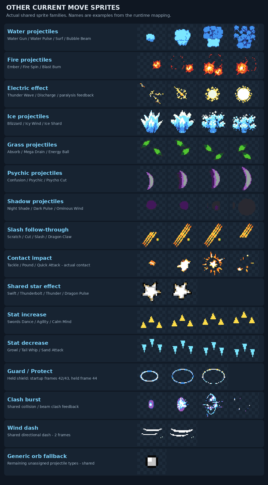

# Current Platinum Arena 0.9.6 move sprites

These are the existing sprites decoded from the current game's DS tile data.
This export changes no game source, art, controls or ROM. No build was made.

[All four beam frames](./current-beam-sprites.png)

Blastoise's default Lab moves are Water Pulse, Hydro Pump, Tackle and Swift.
Hydro Pump uses the cyan continuous strip; Water Pulse uses the water splash frames.
Flamethrower shares its thin/body flame strips with Fire Blast and Sacred Fire.
Several other moves share fallbacks: Thunderbolt currently uses the Swift star,
and nine beams reuse the neutral water-strip geometry. These previews expose
those current mappings rather than presenting proposed replacement art.

[Complete467-move index](./current-move-list.csv) / [Detailed dispatch](./runtime-map.json).
[Download81transparent sprite frames and move list](./Current-096-Move-Sprites.zip).

Loops show unrotated source frames at a fixed length; these are not emulator
captures. Gameplay also positions/scales them and adds contact/guard effects.
Retain the supplied asset credits when editing or sharing these files.
